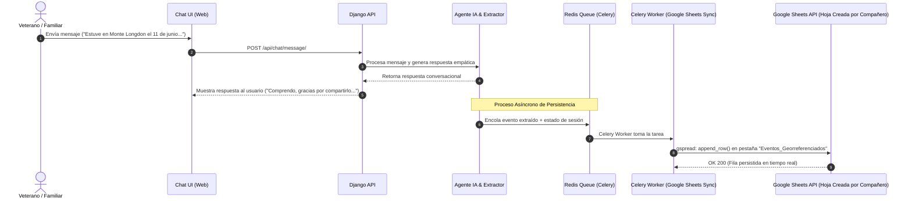
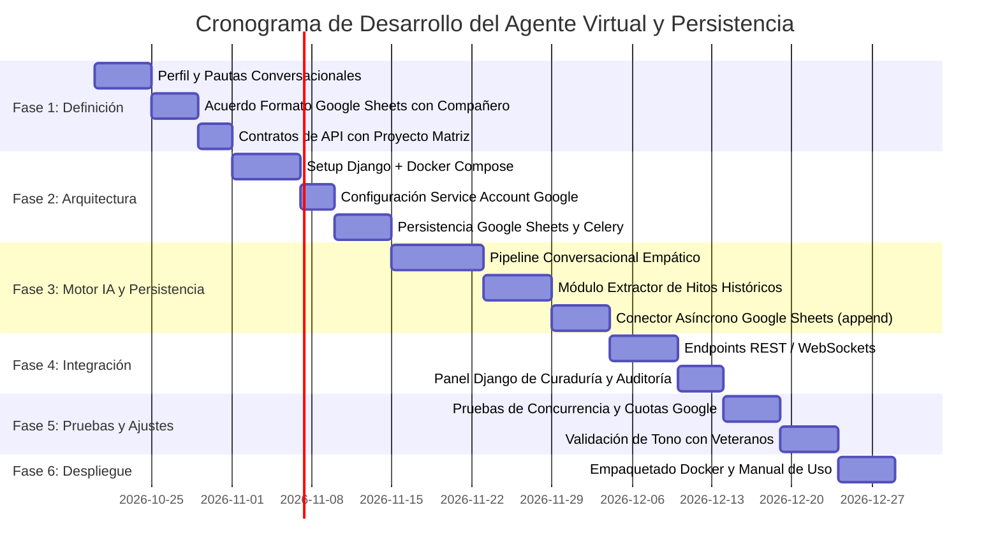

# PLAN DE TRABAJO: AGENTE VIRTUAL TESTIMONIAL - MALVINAS

> **Proyecto:** Plataforma de Memoria Histórica y Georreferenciación de Malvinas  
> **Subproyecto / Módulo:** Agente Conversacional Empático de Recopilación de Testimonios, Extracción Estructurada y Sincronización en Tiempo Real  
> **Framework:** Django + Docker  
> **Destinatarios de la interacción:** Veteranos de la Guerra de Malvinas y sus familiares  
> **Sistema de Persistencia Principal:** Hoja de Cálculo de Google (Google Sheets API v4)  
> **Caché / Sesiones Locales:** SQLite (almacenamiento liviano interno de Django)  
> **Fecha de actualización:** Octubre 2026  
> **Estado:** En planificación e integración  

---

## 1. RESUMEN EJECUTIVO Y OBJETIVOS

### 1.1. Contexto General
El proyecto global (Proyecto Matriz) tiene como fin construir una plataforma web interactiva que centralice, documente y geolocalice acontecimientos históricos ocurridos en el territorio de las Islas Malvinas durante el conflicto de 1982 y su posterior memoria viva. 

Como parte del flujo de trabajo interdisciplinario, **toda la persistencia de la información recopilada por el sistema reside en una Única Hoja de Cálculo de Google (Google Sheets)** creada y administrada de forma externa por otro compañero en su proyecto. Dicha hoja actúa como base de datos y repositorio central compartido para todo el equipo, permitiendo alimentar a futuro las secciones y mapas del proyecto matriz.

### 1.2. Propósito de este Módulo
Desarrollar un **Agente Virtual Conversacional (Chatbot)** dotado de inteligencia artificial, capaz de:
1. **Interactuar de forma empática, respetuosa y paciente** con veteranos de guerra y familiares, proporcionando un entorno seguro de escucha activa.
2. **Guiar la conversación sin ser invasivo**, permitiendo al usuario explayarse a su propio ritmo e introduciendo preguntas de precisión histórica únicamente cuando sea oportuno.
3. **Procesar y estructurar la información testimonial** (identificación de toponimia malvinense, fechas, unidades militares, relatos, hitos y coordenadas aproximadas).
4. **Persistir la información directamente en la Hoja de Cálculo de Google**, anexando en tiempo real cada testimonio y evento histórico extraído a medida que ingresa al sistema.
5. **Cumplir con la delimitación de responsabilidades:** **El agente NO crea automáticamente la hoja de cálculo ni sus pestañas ni sus valores iniciales**, ya que estas son creadas previamente por el compañero en su proyecto. El agente se limita a conectarse a la hoja existente y anexar los datos correspondientes.
6. **Asegurar la portabilidad y robustez técnica**, operando bajo una arquitectura basada en **Django**, contenerizada con **Docker**, y con tareas asíncronas para que la escritura en Google Sheets no degrade la velocidad de respuesta del chat.

---

## 2. PERFIL DEL AGENTE Y PAUTAS ÉTICO-CONVERSACIONALES

El diseño del prompt del sistema y la lógica conversacional deben guiarse por la delicadeza del tema y el respeto absoluto a los protagonistas y sus familias.

| Dimensión | Pauta de Diseño | Implementación Técnica |
| :--- | :--- | :--- |
| **Tono y Registro** | Solemne, cálido, respetuoso y cordial. Tratamiento de "Usted" o "Estimado/a", reconociendo el valor cívico e histórico de su testimonio. | System Prompt con directrices explícitas de estilo y tono empático. |
| **Ritmo de Conversación (Pacing)** | Escucha activa. No bombardear con cuestionarios; priorizar que el usuario comparta lo que sienta cómodo compartiendo. | Lógica de turnos conversacionales que valida el sentimiento antes de indagar detalles técnicos. |
| **Pertinencia de Preguntas** | Repreguntar datos fácticos (lugares, fechas, compañeros, unidades) solo cuando el usuario introduce espontáneamente un evento. | Algoritmo de decisión de repregunta basado en suficiencia de datos del relato. |
| **Manejo de Sensibilidad / Contención** | Si el usuario manifiesta dolor, tristeza o fatiga emocional, priorizar el agradecimiento, validación y ofrecer pausas. | Detección de sentimiento y palabras clave de vulnerabilidad emocional con respuestas de contención protocolar. |
| **Consentimiento Informado** | Claridad total sobre el destino del testimonio (Web de divulgación histórica comunitaria y archivo testimonial). | Mensaje inicial de consentimiento y confirmación explícita antes del procesamiento definitivo. |

---

## 3. ARQUITECTURA TÉCNICA Y PERSISTENCIA DE DATOS

```mermaid
flowchart TD
    subgraph Frontend["Frontend / Interfaz de Usuario"]
        UI[Chat Widget Web / Proyecto Matriz]
    end

    subgraph DockerEnv["Entorno Contenedorizado (Docker Compose)"]
        subgraph DjangoApp["Servicio Django Backend"]
            API[Django REST Framework / Channels]
            AgentCore[Módulo Agente IA: LangChain / LiteLLM]
            Extractor[Motor de Extracción Estructurada]
            AdminPanel[Django Admin: Moderación y Auditoría]
            LocalORM[(SQLite: Sesiones Temporales)]
        end

        subgraph BackgroundWorkers["Servicio de Sincronización Asíncrona"]
            CeleryWorker[Celery Worker / Tareas Async]
            SheetsSync[Módulo Sincronizador Google Sheets]
        end

        subgraph Auxiliary["Broker y Caché"]
            Redis[(Redis: Broker de Tareas & WebSockets)]
        end
    end

    subgraph ExternalSheets["Persistencia Principal (Gestionada por Compañero)"]
        GSheets[("Única Hoja de Cálculo de Google (Google Sheets)\n[Creada en el Proyecto del Compañero]\n- Pestaña: Testimonios_Generales\n- Pestaña: Eventos_Georreferenciados")]
    end

    subgraph Matriz["Consumo Futuro"]
        WebMatriz[API / Mapa Georreferenciado Proyecto Matriz]
    end

    UI <-->|HTTP REST / WebSocket| API
    API <--> AgentCore
    AgentCore --> LocalORM
    AgentCore --> Extractor
    Extractor --> LocalORM
    API <--> Redis

    %% Flujo Asíncrono de Persistencia hacia Google Sheets
    Extractor -.->|Acontecimiento o Testimonio listo| CeleryWorker
    CeleryWorker <--> Redis
    CeleryWorker --> SheetsSync
    SheetsSync -->|API Google Sheets v4 / Service Account (Solo append_row)| GSheets

    %% Consumo Futuro por la Web Matriz
    GSheets -.->|Lectura de Datos a Futuro| WebMatriz
    AdminPanel -->|Aprobación de datos| WebMatriz
```

### 3.1. Tecnologías Seleccionadas
- **Backend Core:** Python 3.11+ y **Django 5.x** (soporte asíncrono y robustez de modelos).
- **APIs & Conectividad en Tiempo Real:** 
  - **Django REST Framework (DRF):** Endpoints REST para sesiones, mensajes y eventos.
  - **Django Channels + Daphne / Redis:** WebSockets para respuestas interactivas y streaming de tokens.
- **Orquestación de IA / LLM:** 
  - **LangChain / LiteLLM / Pydantic:** Invocación de modelos (GPT-4o, Claude 3.5 Sonnet, o locales vía Ollama) con esquemas estrictos de extracción JSON (*Structured Outputs*).
- **Persistencia Principal de Datos: Google Sheets (API v4):**
  - **Librerías:** `gspread` + `google-auth` (usando una **Cuenta de Servicio / Service Account** de Google Cloud).
  - **Gestión Asíncrona:** **Celery + Redis** para que cada persistencia en Google Sheets se encole y procese en segundo plano, evitando latencias de red en el chat y gestionando reintentos automáticos ante cuotas de la API de Google.
  - **Regla Estricta de Creación:** **El agente NO crea la hoja de cálculo ni las pestañas**. Estas son creadas por el compañero en su proyecto. El agente únicamente ejecuta operaciones de adición de filas (`append_row`) en las pestañas preexistentes.
- **Persistencia Local de Sesión:** 
  - **SQLite:** Base de datos liviana interna para almacenar temporalmente el estado de la sesión activa en Django, perfiles de testeo y logs de auditoría sin requerir motores pesados externos.
- **Infraestructura & Despliegue:** 
  - **Docker & Docker Compose:** Servicios orquestados: `web` (Django), `redis` (Cache/Broker), `celery_worker` (Sincronización Sheets).

---

## 4. DISEÑO Y FORMATO DE LA HOJA DE CÁLCULO DE GOOGLE (COMPATIBLE A FUTURO)

La **única hoja de cálculo** es creada de forma externa por el compañero asignado. El agente se acoplará estrictamente a las dos pestañas que el compañero habilitará en dicha hoja:

```
[ ARCHIVO GOOGLE SHEETS ÚNICO ]  <-- Creado por el compañero en su proyecto
  ├── Pestaña 1: "Testimonios_Generales" (Un registro por veterano / sesión)
  └── Pestaña 2: "Eventos_Georreferenciados" (Múltiples hitos asociados a cada testimonio)
```

> **IMPORTANTE (Regla de No Creación Automática):**  
> El agente virtual **NO ejecutará llamadas para crear la hoja (`create spreadsheet`) ni para agregar pestañas (`add_worksheet`)**.  
> El compañero creará la hoja, configurará las cabeceras acordadas en la Fila 1 y compartirá el `SPREADSHEET_ID`. Si una pestaña no existe, el agente emitirá una advertencia y esperará a que el compañero la cree.

---

### 4.1. Pestaña 1: `Testimonios_Generales`
*(Creada por el compañero; el agente solo anexa filas)*

| Columna | Nombre de Cabecera (Técnico) | Tipo de Dato | Ejemplo de Valor | Descripción / Compatibilidad |
| :---: | :--- | :--- | :--- | :--- |
| **A** | `session_id` | String (UUID) | `c7a8b2d1-9f3e-4b2a` | **Clave primaria**. Relaciona los eventos con el testimonio. |
| **B** | `timestamp_inicio` | ISO 8601 (Datetime) | `2026-10-17 14:30:00` | Fecha y hora en que inició la conversación. |
| **C** | `timestamp_fin` | ISO 8601 (Datetime) | `2026-10-17 15:15:22` | Fecha y hora de finalización de la sesión. |
| **D** | `nombre_completo` | String | `Juan Carlos Rodríguez` | Nombre del participante (o "Anónimo"). |
| **E** | `rol_participante` | String (Enum) | `Veterano de Guerra` | `Veterano de Guerra`, `Familiar Directo`, `Personal Sanitario`, `Otro`. |
| **F** | `fuerza_o_unidad` | String | `Ejército Argentino - RI Mec 7` | Fuerza militar o institución a la que perteneció. |
| **G** | `consentimiento_web` | Boolean / String | `SI` | Autorización explícita para publicar en la web (`SI` / `NO`). |
| **H** | `nivel_privacidad` | String (Enum) | `Nombre Público` | `Nombre Público`, `Solo Iniciales`, `Anónimo`. |
| **I** | `cantidad_mensajes` | Entero | `24` | Total de interacciones realizadas en la sesión. |
| **J** | `resumen_relato` | Text (Largo) | `El veterano relata su llegada a Puerto Argentino...` | Síntesis generada por el agente de la vivencia compartida. |
| **K** | `estado_sesion` | String (Enum) | `Completada` | `En Curso`, `Pausada`, `Completada`, `Abandonada`. |
| **L** | `transcripcion_completa`| Text | `[Agente]: Hola... \n[Usuario]: Buenas tardes...` | Registro textual íntegro para fines de preservación oral. |

---

### 4.2. Pestaña 2: `Eventos_Georreferenciados`
*(Creada por el compañero; el agente solo anexa filas)*

| Columna | Nombre de Cabecera (Técnico) | Tipo de Dato | Ejemplo de Valor | Descripción / Compatibilidad |
| :---: | :--- | :--- | :--- | :--- |
| **A** | `event_id` | String (UUID) | `ev-9102-fa81` | **Clave primaria única del evento**. |
| **B** | `session_id` | String (UUID) | `c7a8b2d1-9f3e-4b2a` | **Clave foránea**: Enlaza con `Testimonios_Generales`. |
| **C** | `fecha_registro` | ISO 8601 (Datetime) | `2026-10-17 14:45:10` | Momento exacto en que el sistema insertó la fila en Sheets. |
| **D** | `titulo_suceso` | String | `Combate nocturno en ladera norte` | Título sintético del acontecimiento. |
| **E** | `toponimia_malvinas` | String (Estandarizado) | `Monte Longdon` | Nombre normalizado del lugar en el territorio de Malvinas. |
| **F** | `latitud` | Decimal Float (WGS84) | `-51.6667` | Coordenada decimal para georreferenciación en mapas web (Leaflet/Mapbox). |
| **G** | `longitud` | Decimal Float (WGS84) | `-57.9833` | Coordenada decimal para georreferenciación en mapas web (Leaflet/Mapbox). |
| **H** | `fecha_acontecimiento`| String / Date | `1982-06-11` | Fecha o rango estimado del hecho (`YYYY-MM-DD` o período). |
| **I** | `unidades_involucradas`| String (Separado por comas)| `RI Mec 7, Subteniente Baldini` | Unidades, regimientos o compañías mencionadas. |
| **J** | `descripcion_detalle` | Text | `Defensa de la cresta montañosa durante el avance británico...` | Explicación detallada del hecho histórico. |
| **K** | `cita_textual` | Text | `"Nos encontrábamos en los pozos de zorro cuando..."` | Cita exacta extraída del testimonio oral. |
| **L** | `confianza_extraccion`| Float (0.0 a 1.0) | `0.94` | Nivel de certidumbre del modelo IA sobre los datos extraídos. |
| **M** | `estado_validacion` | String (Enum) | `Pendiente de Revision` | `Borrador IA`, `Pendiente de Revision`, `Aprobado Web`, `Descartado`. |
| **N** | `notas_curador` | Text | `Verificado contra informe oficial del RI 7` | Espacio reservado para que el equipo humano anote validaciones. |

---

### 4.3. Reglas de Normalización y Buenas Prácticas para Futuro Uso
1. **Nombres de cabecera invariables:** Las cabeceras de la fila 1 se mantienen con nombres técnicos en minúsculas y guiones bajos (`snake_case`), sin espacios ni caracteres especiales, facilitando su lectura directa con `pandas.read_csv()` o librerías de Python.
2. **Formato de Coordenadas:** Valores numéricos con punto decimal (WGS84), listos para bibliotecas de mapas (Leaflet, Google Maps, OpenLayers, Mapbox).
3. **Formato de Fechas:** Estándar ISO 8601 (`YYYY-MM-DD` o `YYYY-MM-DD HH:MM:SS`), evitando confusiones de formato regional (`DD/MM` vs `MM/DD`).
4. **Campos Clave Únicos:** La presencia de `session_id` y `event_id` garantiza que nunca se dupliquen filas si se requiere actualizar o reprocesar un registro.

---

## 5. MECANISMO TÉCNICO DE PERSISTENCIA EN TIEMPO REAL



### 5.1. Flujo de Persistencia Continua
- **Al Iniciar la Conversación:** Se inserta una nueva fila en `Testimonios_Generales` con `session_id`, `timestamp_inicio` y estado `En Curso`.
- **Durante la Conversación:** Cada vez que el motor de extracción detecta un acontecimiento con anclaje geográfico o fecha, envía un mensaje asíncrono que ejecuta `append_row` en `Eventos_Georreferenciados`.
- **Al Finalizar la Conversación:** Se actualizan las columnas `resumen_relato`, `cantidad_mensajes`, `timestamp_fin` y `estado_sesion = 'Completada'` en la fila correspondiente de `Testimonios_Generales`.

---

## 6. FASES DETALLADAS DEL PLAN DE TRABAJO



---

### FASE 1: Definición Funcional, Ética y Contrato de Persistencia
*Duración estimada: Semanas 1 y 2*

- [ ] **1.1. Acuerdo del Esquema con el Compañero Responsable de Google Sheets:**
  - Validar los nombres de columnas de las pestañas `Testimonios_Generales` y `Eventos_Georreferenciados`.
  - El compañero crea la hoja de cálculo en su proyecto con las cabeceras predefinidas y fija la primera fila.
  - **Confirmación:** El agente NO creará la hoja ni las pestañas; solo añadirá registros vía API.
- [ ] **1.2. Protocolo de Comunicación y Prompt Engineering:**
  - Redacción del *System Prompt Maestro* con personalidad empática, tono solemne y respeto absoluto.
  - Diseño del árbol de flujo conversacional con validación de consentimiento inicial.
- [ ] **1.3. Diccionario de Toponimia de Malvinas:**
  - Catálogo de lugares con sus coordenadas base (Monte Longdon, Monte Dos Hermanas, Pradera del Ganso, Darwin, Puerto Argentino, San Carlos, Monte Harriet, Monte Tumbledown, etc.) para que la IA proponga coordenadas decimales automáticas.

**Entregables:**
- Plantilla acordada y creada por el compañero en su proyecto.
- Especificación del System Prompt Maestro y diccionario toponímico.

---

### FASE 2: Entorno Django, Dockerización y Configuración de Google API
*Duración estimada: Semanas 3 y 4*

- [ ] **2.1. Configuración de Google Cloud y Service Account:**
  - Generar el archivo de credenciales `credentials.json` (Cuenta de Servicio con roles de lectura/escritura en Google Sheets y Google Drive API).
  - El compañero comparte la hoja de cálculo de Google con el correo de la Service Account (con permisos de *Editor*).
- [ ] **2.2. Arquitectura Django y Docker Compose:**
  - Estructuración del proyecto en apps Django (`chat`, `agent`, `events`, `integrations`).
  - Creación de `docker-compose.yml` integrando:
    - `web`: Servidor Django (Gunicorn/Daphne).
    - `celery_worker`: Tareas en segundo plano para persistir en Google Sheets sin retrasar el chat.
    - `redis`: Message broker y capa de canales.
- [ ] **2.3. Modelos Locales y Caché:**
  - Modelos Django de sesión temporal y caché local de respaldo.

**Entregables:**
- Docker Compose operativo con conectividad verificada hacia Google Sheets mediante script de prueba.

---

### FASE 3: Desarrollo del Motor de IA y Persistencia en Tiempo Real
*Duración estimada: Semanas 5 y 6*

- [ ] **3.1. Chatbot Empático y Pacing Conversacional:**
  - Integración del LLM manteniendo la memoria de conversación.
  - Generación de respuestas amables, pacientes y pertinentes.
- [ ] **3.2. Extractor Estructurado de Eventos Históricos:**
  - Detección de entidades mediante Structured Output (Pydantic / JSON Schema).
  - Asignación de coordenadas geográficas decimales automáticas basadas en la toponimia detectada.
- [ ] **3.3. Servicio Asíncrono de Escritura en Google Sheets (`sheets_sync.py`):**
  - Métodos `sync_new_session()`, `sync_event_realtime()` y `sync_session_completed()`.
  - Verificación estricta de existencia de pestañas (sin crearlas automáticamente).
  - Gestión de cuotas y colas de reintentos (*exponential backoff*).

**Entregables:**
- Chat interactivo que al recibir un testimonio inserta automáticamente la información en la hoja de cálculo existente.

---

### FASE 4: Integración con la Web Matriz y Panel de Curaduría
*Duración estimada: Semanas 7 y 8*

- [ ] **4.1. Endpoints de Consumo para la Web:**
  - Endpoints REST o WebSockets para que el frontend del proyecto matriz embeba el chat.
  - Endpoint `/api/sheets/status/` para monitorear el estado de persistencia de la hoja.
- [ ] **4.2. Panel de Curaduría en Django Admin:**
  - Visualización del historial de chats, los eventos extraídos y el ID de fila en Google Sheets.
  - Posibilidad de auditar y revisar datos.

**Entregables:**
- Endpoints documentados y panel administrativo con control de sincronización.

---

### FASE 5: Pruebas de Sensibilidad, Resiliencia y Carga
*Duración estimada: Semanas 9 y 10*

- [ ] **5.1. Pruebas de Sensibilidad y Casos Límite:**
  - Ensayos con testimonios fragmentados, emotivos o extensos para validar que el agente mantenga la calidez y el respeto.
- [ ] **5.2. Pruebas de Resiliencia en Google Sheets:**
  - Prueba de concurrencia: múltiples conversaciones simultáneas enviando datos sin superar las cuotas de la API de Google (300 escrituras por minuto).
  - Verificación de que los datos no se pisen ni se dupliquen filas.

**Entregables:**
- Reporte de validación técnica y de experiencia de usuario.

---

### FASE 6: Despliegue, Documentación y Entrega al Equipo
*Duración estimada: Semanas 11 y 12*

- [ ] **6.1. Manual de Integración para el Compañero de Google Sheets:**
  - Guía de verificación de filas recibidas en tiempo real.
- [ ] **6.2. Documentación Docker y Entrega:**
  - `README.md` completo para levantar todo el stack con `docker compose up --build`.

**Entregables:**
- Sistema completo desplegado y documentado.

---

## 7. ESTRUCTURA DE ARCHIVOS PROPUESTA PARA EL SUBPROYECTO

```text
MALVINAS/
├── PLAN DE TRABAJO.MD              # Este plan maestro de trabajo y especificación
├── docker-compose.yml              # Orquestación de Django, Celery y Redis
├── Dockerfile                      # Contenedor Django optimizado
├── .env.example                    # Plantilla de variables (claves API, SPREADSHEET_ID, etc.)
├── credentials.json.example        # Ejemplo del archivo de cuenta de servicio de Google
├── requirements.txt                # Django, djangorestframework, channels, gspread, celery, redis, langchain
├── manage.py
├── core/                           # Configuración global del proyecto Django
│   ├── settings.py
│   ├── urls.py
│   ├── asgi.py                     # Soporte ASGI para Channels / WebSockets
│   ├── wsgi.py
│   └── celery.py                   # Configuración del broker Celery
└── apps/
    ├── agent/                      # Lógica del Agente Conversacional
    │   ├── prompts.py              # System prompts de empatía, solemnidad y respeto
    │   ├── engine.py               # Gestión de memoria y llamadas al LLM
    │   └── extractor.py            # Extracción estructurada de toponimia y fechas
    ├── chat/                       # Vistas y WebSockets de la conversación
    │   ├── models.py               # Sesiones y mensajes
    │   ├── views.py                # Endpoints REST
    │   └── consumers.py            # Consumidores WebSocket
    ├── integrations/               # Integración con Servicios Externos
    │   ├── google_sheets.py        # Cliente gspread (operaciones append_row en pestañas existentes)
    │   └── tasks.py                # Tareas asíncronas de Celery para persistencia
    └── events/                     # Gestión interna de hitos históricos
        ├── models.py               # HistoricalEvent
        ├── serializers.py
        └── views.py
```

---

## 8. MATRIZ DE ROLES Y RESPONSABILIDADES EN LA INTEGRACIÓN

| Rol | Integrante | Responsabilidades Concretas |
| :--- | :--- | :--- |
| **Desarrollo del Agente IA & Conector Sheets** | *Tu Rol* | - Programación del agente empático y respetuoso en Django.<br>- Motor de extracción de eventos y coordenadas.<br>- Contenerización con Docker y orquestación con Celery.<br>- Servicio de persistencia en tiempo real (`append_row`) hacia Google Sheets.<br>- **No crear hojas ni pestañas automáticamente** (respetar la estructura provista). |
| **Responsable de la Hoja de Google Sheets** | *Compañero Asignado* | - **Crear la Hoja de Cálculo única en Google Drive en su proyecto**.<br>- **Crear las pestañas `Testimonios_Generales` y `Eventos_Georreferenciados` con sus cabeceras iniciales**.<br>- Otorgar permisos de *Editor* al email de la Service Account.<br>- Proveer el `SPREADSHEET_ID` para configurarlo en el `.env`. |
| **Frontend / Web Matriz** | *Compañeros* | - Integrar la ventana de chat en el portal web.<br>- Consumir la API de eventos o leer directamente de Google Sheets para alimentar mapas y fichas de hitos. |
| **Curaduría Histórica** | *Equipo Conjunto* | - Revisar la pestaña de eventos en Google Sheets y cambiar el estado de validación a `Aprobado Web`. |

---

## 9. MATRIZ DE RIESGOS Y MEDIDAS DE MITIGACIÓN

| Riesgo | Impacto | Probabilidad | Medida de Mitigación |
| :--- | :--- | :--- | :--- |
| **Pestaña inexistente en Google Sheets** | Medio | Baja | Validación previa al envío: el agente no crea la pestaña; si no existe, emite un aviso para que el compañero la active en su proyecto. |
| **Límite de cuota de Google Sheets API (Rate Limit)** | Alto | Media | Uso obligatorio de **Celery + Redis** para encolar escrituras y agrupar inserciones (*batch updates*), evitando sobrepasar los límites de escritura de Google. |
| **Cortes transitorios de internet o fallo en Google API** | Medio | Media | Cola de reintentos automáticos en Celery con retroceso exponencial (*exponential backoff*). |
| **Desorden o incompatibilidad de datos para uso futuro** | Alto | Baja | Definición de nombres de columnas técnicos estrictos (`snake_case`), tipos de datos universales (ISO 8601, Float WGS84, UUID) y separación en pestañas relacionales. |
| **Veterano abrumado o angustiado durante el relato** | Alto | Media | Detección de sentimientos en el agente; respuestas inmediatas de contención, pausas y respeto total por sus tiempos emocionales. |
| **Diferencias de configuración entre miembros del equipo** | Medio | Media | Todo el entorno corre bajo Docker Compose (`docker compose up --build`), garantizando idéntico comportamiento en cualquier equipo. |
