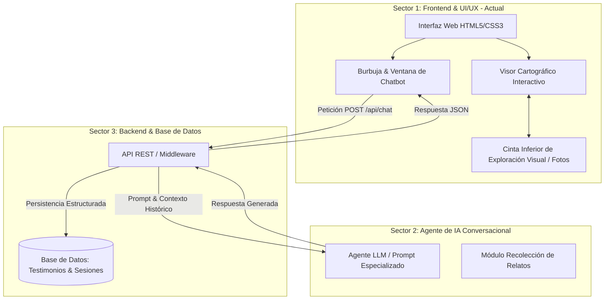

# Plan de Trabajo: Plataforma Web Interactiva "Malvinas 1982: Memoria, Territorio y Testimonios"

---

## 1. Información General del Proyecto

- **Nombre del Proyecto:** Portal Conmemorativo e Interactivo "Malvinas 1982: Memoria Viva"
- **Objetivo General:** Desarrollar una plataforma web integral, interactiva y multidisciplinaria orientada a la difusión histórica, el análisis cartográfico por escalas geográficas y la preservación de la memoria viva de la Guerra de Malvinas (1982). El sistema articula cartografía interactiva vinculada a registros fotográficos y un agente conversacional de Inteligencia Artificial que permite recopilar testimonios de veteranos y responder consultas históricas.
- **Equipo de Trabajo:** 3 integrantes (divididos en 3 sectores funcionales desacoplados con contratos de integración estandarizados).

---

## 2. Estructura de Trabajo por Sectores y Responsabilidades



### Sector 1: Desarrollo Frontend y Experiencia de Usuario (UI/UX)
* **Responsable:** Integrante 1 (Sector Actual).
* **Tecnologías:** HTML5 Semántico, CSS3 Moderno (Vanilla CSS), JavaScript (ES6+), Leaflet.js / API Cartográfica.
* **Entregables Principales:**
  1. **Landing Page Conmemorativa:** Maquetación moderna, sobria y 100% adaptable a dispositivos móviles y de escritorio.
  2. **Explorador Cartográfico Interactivo con Galería Inferior:** Visor de mapas fluido (inspirado en el paradigma visual de Google Maps/Earth) con marcadores de eventos históricos, control de escalas/zoom y sincronización bidireccional con una cinta inferior de fotos históricas extraídas de `/imagenesdeescala`.
  3. **Widget Flotante de Chatbot:** Burbuja interactiva colapsable con soporte para dos modalidades: *Consulta Histórica* y *Registro de Testimonio de Veterano*.
  4. **Capa de Abstracción de Red (Service Layer):** Módulo en JavaScript con soporte dual (modo mock/simulado para pruebas locales y modo producción conectado a la API del Sector 3).

---

### Sector 2: Inteligencia Artificial y Procesamiento del Lenguaje Natural (PLN)
* **Responsable:** Integrante 2.
* **Tecnologías:** Modelos LLM, Python / Node.js, LangChain / SDKs de IA.
* **Entregables Principales:**
  1. **Agente Conversacional Especializado:** Modelado de prompts con enfoque historiográfico riguroso, empático y solemne sobre el conflicto de 1982.
  2. **Módulo de Entrevista para Veteranos:** Árbol de diálogo empático que guía al veterano para registrar: unidad/regimiento, teatro de operaciones, rol de combate y vivencias personales.
  3. **Modo Consulta General:** Respuestas fundamentadas a inquietudes de estudiantes e investigadores sobre fechas, armamento, batallas y tratados.

---

### Sector 3: Backend, API REST y Persistencia (Base de Datos)
* **Responsable:** Integrante 3.
* **Tecnologías:** Node.js (Express) o Python (FastAPI); Base de datos relacional (PostgreSQL/MySQL) o NoSQL (MongoDB).
* **Entregables Principales:**
  1. **Servidor API REST:** Enrutador seguro para orquestar la comunicación entre el Frontend (Sector 1) y el Agente de IA (Sector 2).
  2. **Esquema de Base de Datos:** Persistencia de:
     - Sesiones de chat e historial de consultas.
     - Registro estructurado de testimonios de veteranos (campos: nombre/seudónimo, arma, batallón, ubicación geográfica, relato completo y fecha).
  3. **Seguridad y CORS:** Habilitación de políticas de origen cruzado para despliegue local y en producción.

---

## 3. Especificación Técnica de los Módulos del Frontend (Sector 1)

### 3.1. Módulo Cartográfico: Análisis y Asesoramiento Técnico (Google Maps vs. Leaflet.js)

Se analizó la viabilidad de utilizar el servicio de **Google Maps** frente a librerías cartográficas de código abierto para lograr la experiencia mostrada en el prototipo de referencia:

```
┌────────────────────────────────────────────────────────────────────────┐
│                        MAPA INTERACTIVO                                │
│       [Marcador: Puerto Argentino]          [Marcador: Darwin]         │
│                        (Zoom / Capas / Escalas)                        │
└────────────────────────────────────────────────────────────────────────┘
┌────────────────────────────────────────────────────────────────────────┐
│  [Foto 1]   │  [Foto 2]   │  [Foto 3]   │  [Foto 4]   │  [Foto 5] ...  │
│  Pto. Arg.  │  Mte.Longdon│  San Carlos │  Goose Green│  BIM 5         │
└────────────────────────────────────────────────────────────────────────┘
               ▲ Cinta Inferior de Exploración Fotográfica
```

#### Cuadro Comparativo de Viabilidad Técnica:

| Criterio | Google Maps JavaScript API | Leaflet.js + Tiles Abiertos (Recomendado) |
| :--- | :--- | :--- |
| **Costo y Requisitos** | Requiere cuenta Google Cloud y tarjeta de crédito para activar facturación (facturación por consumo de créditos). | **100% Gratuito y Libre.** Sin tarjetas, sin API Keys obligatorias ni límites de solicitudes. |
| **Renderizado en Sistema Propio** | Sí, mediante SDK JavaScript (`@googlemaps/js-api-loader`). No es viable con simple `<iframe>` si se busca sincronizar clics con la galería inferior. | **Directo y nativo.** Se integra con 1 línea de script y 1 contenedor `<div>` en el DOM propio. |
| **Toponimia y Soberanía Histórica** | Por defecto, Google Maps puede mostrar toponimia británica (*Falkland Islands / Stanley*) si no se fuerza la configuración regional (`region=AR&language=es`). | **Control total del equipo.** Se configuran marcadores oficiales argentinos (Puerto Argentino, Monte Longdon, Darwin, etc.). |
| **Sincronización con Galería Inferior** | Posible mediante eventos de la API de Google, pero más compleja de configurar. | **Extremadamente sencilla.** Al hacer clic en una foto inferior, se invoca `map.flyTo([lat, lng], zoom)` y se resalta el punto. |

> **Decisión Técnica Adoptada:** Se implementará el visor con **Leaflet.js** utilizando capas satelitales (Esri World Imagery o CartoDB) combinadas con los marcadores georreferenciados del equipo. Esto permite replicar con exactitud la estética de Google Maps sin costo, sin riesgos de bloqueo por cuotas y con soberanía total sobre los nombres y fotografías históricas.

### 3.2. Cinta Inferior de Exploración Visual (`/imagenesdeescala`)
* **Ubicación:** Barra horizontal fija en la base de la pantalla, colapsable mediante un botón de alternancia (*Toggle Bar*).
* **Interacción Bidireccional:**
  - Al hacer clic en una miniatura fotográfica de la cinta, la cámara del mapa se desplaza suavemente (*smooth pan/zoom*) hacia la coordenada exacta del combate o hito histórico.
  - Al hacer clic en un marcador del mapa, la cinta inferior desplaza automáticamente el carrusel hacia la fotografía correspondiente y despliega un panel de información histórica.
* **Estructura de Datos del Mapa (`puntosHistoricos` en `app.js`):**
```javascript
const PUNTOS_HISTORICOS = [
  {
    id: "pto-argentino",
    nombre: "Puerto Argentino",
    coordenadas: [-51.6921, -57.8583],
    escalaRecomendada: 14,
    imagen: "imagenesdeescala/puerto_argentino.jpg",
    descripcion: "Capital de las islas y centro neurálgico de las operaciones en 1982."
  },
  {
    id: "monte-longdon",
    nombre: "Monte Longdon",
    coordenadas: [-51.6583, -57.9833],
    escalaRecomendada: 15,
    imagen: "imagenesdeescala/monte_longdon.jpg",
    descripcion: "Escenario de uno de los combates nocturnos más intensos de la infantería (11-12 de junio)."
  },
  {
    id: "pradera-del-ganso",
    nombre: "Pradera del Ganso (Goose Green)",
    coordenadas: [-51.8286, -58.9722],
    escalaRecomendada: 14,
    imagen: "imagenesdeescala/pradera_del_ganso.jpg",
    descripcion: "Primera gran batalla terrestre del conflicto bélico (28 de mayo)."
  }
];
```

### 3.3. Widget de Chatbot (Burbuja Flotante)
* **Estado Colapsado:** Botón circular flotante (`position: fixed; bottom: 90px; right: 24px` para no superponerse a la cinta de fotos) con icono temático y efecto de pulso visual.
* **Estado Expandido:** Ventana de conversación modal de 380px × 540px con:
  - Selector de modo: `Contar mi historia (Veterano)` o `Consulta Histórica`.
  - Historial de mensajes con diferenciación clara entre usuario y bot.
  - Indicador animado de "Escribiendo...".
  - Campo de texto con envío por botón o tecla `Enter`.

---

## 4. Contrato de Integración entre Sectores (API REST)

Para asegurar la independencia de desarrollo y evitar demoras entre integrantes:

### 4.1. Envío de Mensaje / Consulta / Historia
* **Método:** `POST`
* **Endpoint:** `/api/chat`
* **Payload (Frontend -> API):**
```json
{
  "sessionId": "usr-session-9876",
  "tipo": "testimonio_veterano",
  "mensaje": "Presté servicio en el Regimiento de Infantería 7 en Wireless Ridge...",
  "metadatos": {
    "veteranoNombre": "Juan Pérez (o Anónimo)",
    "unidad": "RI 7",
    "ubicacionId": "monte-longdon"
  },
  "timestamp": "2026-10-17T21:00:00Z"
}
```

* **Respuesta (API -> Frontend):**
```json
{
  "status": "success",
  "respuesta": "Gracias por su testimonio, su vivencia en Wireless Ridge es invaluable para la memoria nacional. ¿En qué fecha aproximada tuvo lugar su repliegue?",
  "guardadoEnDB": true,
  "testimonioId": "rec-5521"
}
```

---

## 5. Estructura de Archivos del Proyecto

```plaintext
plandetrabajo/
│
├── plandetrabajo.md               # Plan de trabajo formalizado y especificación del proyecto
├── image.png                      # Referencia visual de la interfaz de navegación por mapa y fotos
│
├── imagenesdeescala/              # Galería de imágenes históricas y puntos georreferenciados
│   ├── puerto_argentino.jpg
│   ├── monte_longdon.jpg
│   ├── pradera_del_ganso.jpg
│   └── san_carlos.jpg
│
├── index.html                     # Estructura semántica: Hero, Contenedor de Mapa, Cinta de Fotos y Chat
├── styles.css                     # Sistema de diseño, variables de color, maquetación del mapa y animaciones
└── app.js                         # Inicialización cartográfica, sincronización mapa-galería y cliente API
```

---

## 6. Cronograma de Trabajo y Fases de Ejecución

```mermaid
gantt
    title Cronograma de Trabajo del Proyecto Malvinas 1982
    dateFormat  YYYY-MM-DD
    section Fase 1: Arquitectura y Diseño
    Plan de Trabajo y Contratos de Integración :done, a1, 2026-10-01, 3d
    Selección de Motor Cartográfico e Interfaz :done, a2, after a1, 2d
    section Fase 2: Desarrollo Sectorizado
    S1: Mapa Interactivo y Galería de Fotos    :active, b1, after a2, 5d
    S1: Widget de Chatbot y Mock de Pruebas    :active, b2, after b1, 4d
    S2: Prompt Engineering y Agente de Relatos :b3, after a2, 7d
    S3: Endpoints API REST y Modelado de BD    :b4, after a2, 7d
    section Fase 3: Integración
    Integración S1 + S3 (Conexión Frontend-API):c1, after b2, 4d
    Integración S2 + S3 (Conexión API-Agente)  :c2, after b3, 4d
    Pruebas Integrales y Casos de Uso          :c3, after c1, 3d
    section Fase 4: Entrega
    Control de Calidad, Despliegue y Demo      :d1, after c3, 2d
```

---

## 7. Criterios de Aceptación y Evaluación

1. **Interactividad Cartográfica Fluida:** El usuario puede explorar las islas, hacer zoom en las zonas de conflicto y desplazarse haciendo clic tanto en los marcadores del mapa como en la cinta inferior de fotografías.
2. **Toponimia Soberana e Histórica:** Los nombres de parajes, montes, estrechos e islas deben corresponder a la toponimia oficial histórica argentina (ej. *Puerto Argentino*, *Isla Gran Malvina*, *Estrecho de San Carlos*).
3. **Autonomía del Frontend:** La interfaz debe funcionar de forma independiente con datos simulados (*Mock Data*) mientras el Sector 3 finaliza la API.
4. **Respeto y Preservación Testimonial:** Toda narración ingresada por excombatientes debe procesarse con empatía y quedar estructurada para su almacenamiento permanente en la base de datos.